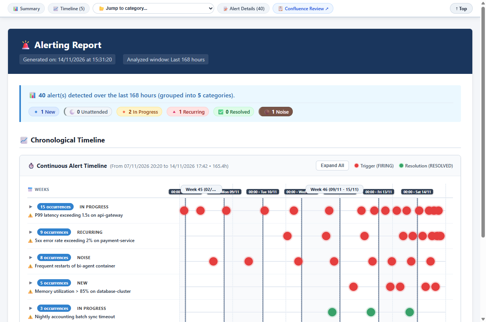

# 🚨 Mattermost Alerting & Confluence Action Tracking

[](https://www.python.org/)

The script generates a report from a Mattermost channel and updates monitoring pages in Confluence to track alerts. 

**This project is designed to address real production needs.**

---

<a id="table-of-contents"></a>
## 📑 Table of Contents

- [Context](#context)
- [Key Features](#key-features)
- [Installation](#installation)
- [Configuration](#configuration)
- [Usage](#usage)
  - [🌟 Standalone Demo Mode](#demo-mode)
  - [📋 CLI Options](#cli-options)
  - [Standard Execution](#standard-execution)
  - [Execution with Confluence Action Tracking](#confluence-tracking)
  - [Custom Time Window](#custom-time-window)
  - [Custom Output File](#custom-output-file)
  - [Running Automated Unit Tests](#unit-tests)
- [Confluence Integration Architecture](#confluence-architecture)
- [GitLab CI/CD Automation](#gitlab-ci)

---

<a id="context"></a>
## Context

As an Application Manager / SRE-oriented, I developed this script to meet the company’s needs for improving its alert monitoring policy.

**Mattermost was used as an alert notification tool**: each new Prometheus alert was forwarded to a Mattermost channel, and then a notification was sent to the team. A “FIRING” alert message was sent when an alert was triggered, and a “RESOLVED” alert message was sent when an alert was resolved. 

**Tracking wasn't optimal** at all because Mattermost is a messaging tool. A lot of information got lost as people scrolled through the channels, **many alerts were no longer even looked at**, and eventually the team could miss crucial alerts that needed to be analyzed.

To address these issues, I developed this script using Gemini CLI to **improve the inadequate alert tracking**, which helped reduce the number of false positives, identify many recurring production alerts, and drill down to the root cause of the problems.

The script was automatically run every Monday morning by a GitLab pipeline to analyze the alerts from the previous week. We would meet right after the deliverables were generated to **review the most impactful alerts and take the appropriate action, noted on the Confluence pages**.

We also ran the script locally from time to time to analyze a longer time frame—even **spanning several years—to identify the most frequent and  impactful alerts**.


---

<a id="key-features"></a>
## Key Features


*Interactive chronological timeline exemple from demo mode*

- **⏱️ Interactive Chronological Timeline**:
  - Continuous linear visualization of alert triggers (`FIRING`) and resolutions (`RESOLVED`).
  - Proportional positioning on an adaptive time axis with day markers and weekly/monthly grouping.
  - Drill-down per category into months, days, and individual occurrences with direct links to Mattermost posts.

- **🔄 Bidirectional Confluence Action Tracking (6-State Lifecycle Machine)**:
  - **🔹 `NEW`**: First detection. Prompts root-cause investigation and team triage.
  - **⚪ `UNATTENDED`**: Unassigned alert awaiting triage. *Automatic countdown warning at 4 weeks, automatic purge after 1 month.*
  - **🔸 `IN PROGRESS`**: Action item assigned to an owner with target due date.
  - **🔺 `RECURRING`**: Automatically triggered if a previously resolved or archived alert fires again.
  - **✅ `RESOLVED`**: Team fix deployed and verified. *Automatically archived after 1 month.*
  - **🟤 `NOISE`**: Known incompressible noise, automatically isolated in a dedicated secondary table.
- **📦 Multi-Page Confluence Ecosystem**:
  - **Active Board**: Primary review register with status palette, quick copy/paste helpers, and cross-navigation.
  - **Archive Board**: Clean 6-column historical record of resolved alerts (> 1 month).
  - **Weekly Statistics**: Automated weekly metrics log with the visual HTML report attached via REST API.

---

<a id="installation"></a>
## Installation

1. Navigate to the project directory:
   ```bash
   cd alerting
   ```

2. Create and activate a virtual environment:
   ```bash
   python -m venv venv
   source venv/bin/activate  # On Linux/macOS
  
   .\venv\Scripts\activate # On Windows:
   ```

3. Install dependencies:
   ```bash
   pip install -r requirements.txt
   ```

---

<a id="configuration"></a>
## Configuration

Create a `.env` file at the root of `alerting/` (or copy `.env.example`):

```env
# Mattermost Configuration
MATTERMOST_URL=https://mattermost.yourdomain.com
MATTERMOST_TOKEN=your_bot_or_user_token
MATTERMOST_CHANNEL_ID=your_channel_id
MATTERMOST_TEAM=your_team

# General Options
EXCLUDED_ALERT_TITLES=Batche(s)
APP_TIMEZONE=Europe/Paris
MAX_DETAILED_ALERTS=200

# Confluence Review Tracking (Optional)
CONFLUENCE_URL=https://confluence.yourdomain.com
CONFLUENCE_TOKEN=your_personal_access_token
CONFLUENCE_PAGE_ID=123456789
CONFLUENCE_ARCHIVE_PAGE_ID=123456780
CONFLUENCE_STATS_PAGE_ID=123456781
CONFLUENCE_DISABLED=false
CONFLUENCE_TRACKING=false
```

---

<a id="usage"></a>
## Usage

<a id="demo-mode"></a>
### Standalone Demo Mode (Zero Configuration Required)

Run the tool instantly **without needing access to any Mattermost or Confluence server**. Generates a realistic 7-day microservices incident dataset (40 alerts) and simulates the full Confluence lifecycle (reconciliation, recurrences, noise isolation, archiving):

```bash
python main.py --demo
```

To generate and automatically open the report in your default browser:
```bash
python main.py --demo --open
```

In demo mode, the script generates **4 interconnected local HTML files** in `output/`:
1. `output/alertes.html`: Main visual alerting report (interactive timeline, badges, KPIs, and links).
2. `output/confluence_suivi.html`: Authentic Confluence Server rendering of the **active review board** (Atlassian AUI status lozenges, copy/paste palette, secondary noise table).
3. `output/confluence_archive.html`: Confluence rendering of the **archive board** showing alerts resolved over 1 month ago.
4. `output/confluence_stats.html`: Confluence rendering of the **weekly statistics log** with the HTML report attachment.

*💡 Click on **"Edit on Confluence ↗"** from the alerting report to jump directly to the corresponding row in `confluence_suivi.html` with smooth scrolling and blue row highlighting!*

---

<a id="cli-options"></a>
### Command Line Interface (CLI) Options

| Option | Type / Values | Default | Description |
| :--- | :--- | :--- | :--- |
| **`--demo`** | Flag | `false` | Runs standalone demo mode with in-memory simulated data. |
| **`--open`** | Flag | `false` | Automatically opens the generated HTML report in the default browser. |
| **`--hours`** | Strictly positive integer | `24` *(or `168` in `--demo`)* | Number of hours of history to analyze (e.g. `168` for 7 days). |
| **`--output`** | File path | `output/alertes.html` | Custom output file path for the generated HTML report. |
| **`--confluence-tracking`** | Boolean (`true`/`false`) or Flag | Env `CONFLUENCE_TRACKING` *(or `true` in `--demo`)* | Enables or disables Confluence synchronization and reconciliation. |

*Note: `--suivi-confluence` is supported as a backward-compatible alias for `--confluence-tracking`.*

---

<a id="standard-execution"></a>
### Standard Execution (Mattermost only, without Confluence)

```bash
python main.py
```

<a id="confluence-tracking"></a>
### Execution with Confluence Action Tracking

```bash
python main.py --hours 168 --confluence-tracking
# or explicitly with a boolean:
python main.py --hours 168 --confluence-tracking=true
python main.py --hours 168 --confluence-tracking=false
```

<a id="custom-time-window"></a>
### Custom Time Window

```bash
python main.py --hours 48
```

<a id="custom-output-file"></a>
### Custom Output File

```bash
python main.py --output /path/to/custom_report.html
```

<a id="unit-tests"></a>
### Running Automated Unit Tests

```bash
python -m pytest -v
```

---

<a id="confluence-architecture"></a>
## Confluence Integration Architecture

The Confluence integration centers around **3 interconnected wiki pages**:

| Confluence Page | Role | Environment Variable | Default Identifier |
| :--- | :--- | :--- | :--- |
| **1. Active Review Board** | Main qualification table, secondary noise table, copy/paste lozenge palette, review checklist. | `CONFLUENCE_PAGE_ID` | `123456789` |
| **2. Archive Board** | Permanent historical record of decisions on alerts resolved over 1 month ago (6 columns without status). | `CONFLUENCE_ARCHIVE_PAGE_ID` | `123456780` |
| **3. Statistics Log** | Weekly journal tracking 12 evolution metrics run by run with the generated HTML report attached. | `CONFLUENCE_STATS_PAGE_ID` | `123456781` |

### Active Board Columns:
1. **Status**: `<ac:structured-macro ac:name="status">` (`NEW`, `UNATTENDED`, `IN PROGRESS`, `RECURRING`, `RESOLVED`, `NOISE`)
2. **Alert Category**: Category description + `<ac:structured-macro ac:name="anchor">` for deep linking
3. **Occurrences**: Current week occurrences
4. **Last Seen in Mattermost**: Native `<time datetime="YYYY-MM-DD" />` tag + time
5. **Assignee**: Team member responsible for the action item
6. **Due Date**: Target resolution date (`<time>` or `-`)
7. **Action Items (Review Meeting)**: Team decisions, tickets, and mitigation plan

---

<a id="gitlab-ci"></a>
## GitLab CI/CD Automation

The included `.gitlab-ci.yml` automates execution:

1. **Project Variables**: Under GitLab (**Settings > CI/CD > Variables**), configure:
   - `MATTERMOST_URL`
   - `MATTERMOST_TOKEN` 
   - `MATTERMOST_CHANNEL_ID`
   - `CONFLUENCE_URL`
   - `CONFLUENCE_TOKEN`
   - `CONFLUENCE_PAGE_ID`
   - `CONFLUENCE_ARCHIVE_PAGE_ID` 
   - `CONFLUENCE_STATS_PAGE_ID`

2. **Schedule**: Under GitLab (**Build > Pipeline schedules**):
   - Interval Pattern: `30 10 * * 1` (Every Monday at 10:30 AM for example).
   - Variables: `WEEKLY_HOURS="--hours=168"` (If you want to analyse alerts on a weekly basis for instance), `CONFLUENCE_TRACKING_ARG="--confluence-tracking=true"`.

3. **Artifacts**: The generated report `output/alertes.html` is automatically preserved as a job artifact.

---
